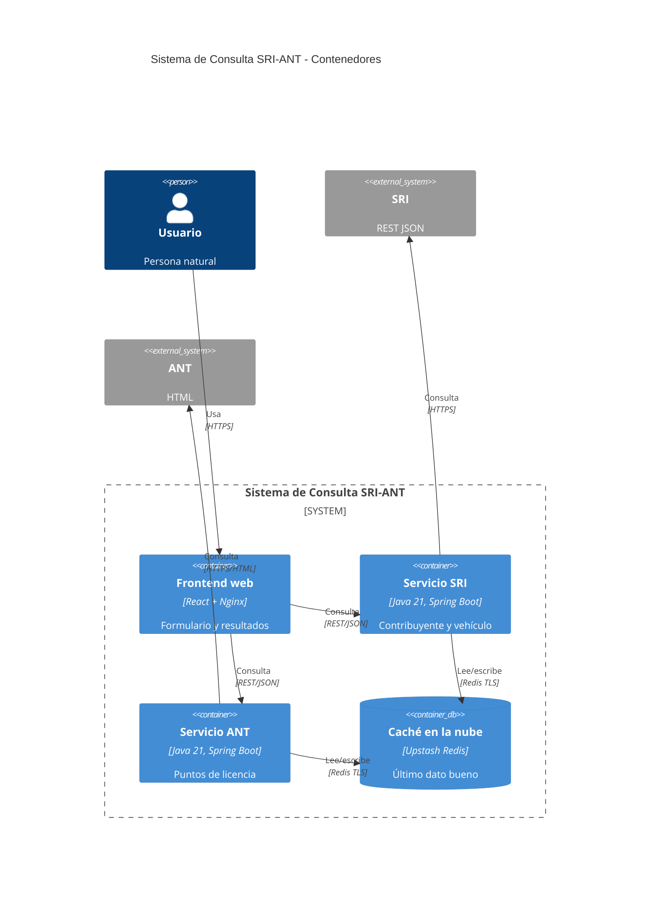

# Modelo C4 en IcePanel (Contexto + Contenedores) y enlace a GitHub

Esta guía es 100 % manual: IcePanel se opera desde su web (https://app.icepanel.io). Los nombres de botones pueden variar un poco si IcePanel actualiza su interfaz, pero la lógica es la misma.

## Paso 0. Sube el código a GitHub (antes de IcePanel)

IcePanel solo puede enlazar carpetas que ya existan en GitHub.

```bash
cd consulta-sri-ant
git init
git add .
git commit -m "Sistema de consulta SRI + ANT con caché"
git branch -M main
git remote add origin https://github.com/ElianHidalgo/consulta-sri-ant.git   # crea antes el repo vacío en github.com
git push -u origin main
```

Se usa **un solo repositorio (monorepo)** con las carpetas `frontend/`, `backend/sri-service/` y `backend/ant-service/`. Así enlazas todo con una sola integración.

## Paso 1. Crear la cuenta y el Landscape

1. Entra a https://app.icepanel.io e inicia sesión (puedes usar tu cuenta de GitHub).
2. Crea una organización si te la pide y luego un **Landscape** (es el "proyecto"). Nómbralo `Consulta SRI y ANT`.
3. Verás las secciones principales: **Diagrams** (diagramas), **Model objects** (objetos del modelo) y **Connections** (relaciones).

## Paso 2. Nivel 1 – Contexto

IcePanel construye el modelo creando objetos que luego aparecen en los diagramas. Crea un diagrama nuevo (**Diagrams → New diagram**) llamado `1. Contexto` y agrega estos objetos con el botón de agregar objeto del lienzo (o doble clic):

| Tipo | Nombre | Descripción |
|---|---|---|
| Actor | Usuario | Persona natural que consulta su RUC, vehículo y puntos de licencia |
| System | Sistema de Consulta SRI-ANT | Verifica contribuyente, vehículo y puntos de licencia |
| System (marcar como **External**) | SRI | Servicios públicos del SRI: catastro de contribuyentes y matriculación vehicular |
| System (marcar como **External**) | ANT | Web de consulta de citaciones y puntos de la Agencia Nacional de Tránsito |

Conexiones (arrastra desde el borde de un objeto hacia el otro; luego escribe nombre y tecnología):

| Origen → Destino | Nombre | Tecnología |
|---|---|---|
| Usuario → Sistema de Consulta | Consulta RUC, matrícula y puntos | HTTPS |
| Sistema de Consulta → SRI | Verifica contribuyente y obtiene vehículo | HTTPS / REST JSON |
| Sistema de Consulta → ANT | Obtiene puntos de la licencia | HTTPS / HTML |

## Paso 3. Nivel 2 – Contenedores

1. Haz doble clic sobre **Sistema de Consulta SRI-ANT** (o crea un diagrama nuevo `2. Contenedores` y elige ese sistema como padre). IcePanel te permite "entrar" al sistema y crear objetos hijos de tipo **App** / **Store**.
2. Crea estos objetos dentro del sistema:

| Tipo | Nombre | Tecnología | Descripción |
|---|---|---|---|
| App | Frontend web | React 18, Vite, TypeScript, Nginx | SPA con el formulario; Nginx la sirve y enruta `/api` a cada microservicio |
| App | Servicio SRI | Java 21, Spring Boot 3 | Valida RUC y placa, consulta al SRI, guarda y respalda desde caché |
| App | Servicio ANT | Java 21, Spring Boot 3, Jsoup | Consulta la web de la ANT, extrae los puntos, guarda y respalda desde caché |
| Store | Caché en la nube | Upstash Redis (TLS) | Guarda el último dato bueno de cada consulta con su fecha y TTL |

Las tecnologías se eligen en el campo **Technology** del objeto (IcePanel trae un catálogo: busca Java, Spring Boot, React, Nginx, Redis).

3. Conexiones del nivel 2:

| Origen → Destino | Nombre | Tecnología |
|---|---|---|
| Usuario → Frontend web | Usa el navegador | HTTPS |
| Frontend web → Servicio SRI | Consulta contribuyente y vehículo (`GET /api/v1/contribuyentes`, `/vehiculos`) | REST / JSON |
| Frontend web → Servicio ANT | Consulta puntos (`GET /api/v1/licencias/{cedula}/puntos`) | REST / JSON |
| Servicio SRI → SRI | Consulta catastro y matriculación | HTTPS / REST JSON |
| Servicio ANT → ANT | Consulta citaciones y puntos | HTTPS / HTML |
| Servicio SRI → Caché en la nube | Guarda y lee el último dato bueno | Redis (TLS) |
| Servicio ANT → Caché en la nube | Guarda y lee el último dato bueno | Redis (TLS) |

4. Verifica que en el diagrama de contenedores aparezcan también los sistemas externos SRI y ANT y el actor Usuario (arrástralos desde el modelo si no están).

> Si cada contenedor tiene un nombre distinto al del código, la rúbrica puede considerar que "no coincide con lo implementado". Usa exactamente los nombres de la tabla de `README.md`.

## Paso 4. Conectar GitHub y enlazar cada contenedor al código

1. Conecta GitHub con IcePanel. Dentro de IcePanel busca la opción de integraciones del organization/landscape (**Manage → Integrations** o desde la sección de **Links** de un objeto → conectar GitHub), pulsa **GitHub** y autoriza.
2. En la pantalla de GitHub elige **Only select repositories** y marca `consulta-sri-ant` (o "All repositories"), y acepta **Install**.
3. Vuelve a IcePanel. Selecciona un objeto, baja en la pestaña **Details** hasta la sección **Links** y pulsa **+ Add link**. Elige el tipo (repo, branch, carpeta o archivo) y selecciona el destino.

Enlaza así:

| Objeto en IcePanel | Enlace en GitHub |
|---|---|
| Frontend web | carpeta `frontend` |
| Servicio SRI | carpeta `backend/sri-service` |
| Servicio ANT | carpeta `backend/ant-service` |
| Sistema de Consulta SRI-ANT | repositorio completo `consulta-sri-ant` |

Notas:
- El plan gratuito permite enlazar hasta 10 objetos; con los 4 de arriba basta.
- Si no aparece el repo, espera unos minutos y refresca; si tu GitHub tiene restricciones por IP, IcePanel indica en su documentación qué IP autorizar.
- IcePanel revisa los enlaces cada 30–60 minutos; un enlace roto baja el puntaje de exactitud ("inaccuracy score"), por eso no renombres carpetas después.

## Paso 5. Obtener el enlace de lectura

1. Abre el diagrama y pulsa **Share** (arriba a la derecha).
2. Abre la pestaña **Share link** y actívala.
3. Copia el enlace. Es de **solo lectura** y los espectadores no necesitan cuenta.
4. **Pruébalo**: ábrelo en una ventana de incógnito. Debe mostrar el diagrama sin pedir login. Si el enlace "no abre", la rúbrica baja a 0.5 puntos.
5. Comparte un enlace al **Landscape** (que incluya los dos diagramas) o entrega los dos enlaces (uno por diagrama).

## Lista de verificación antes de entregar

- [ ] Existen el diagrama de Contexto y el de Contenedores.
- [ ] Los nombres coinciden con las carpetas/servicios reales.
- [ ] Los 3 contenedores de código tienen un **Link** a su carpeta en GitHub.
- [ ] El enlace de lectura abre en incógnito.
- [ ] El README del repo incluye el enlace de IcePanel (sugerencia: agrégalo bajo el título).

## Referencia rápida del modelo (por si prefieres revisar en texto)


